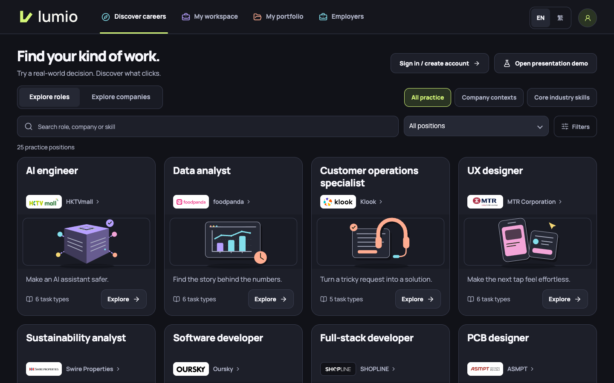
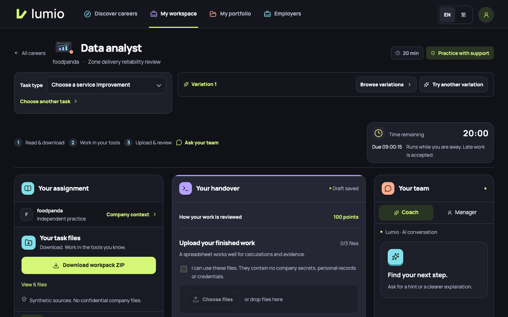
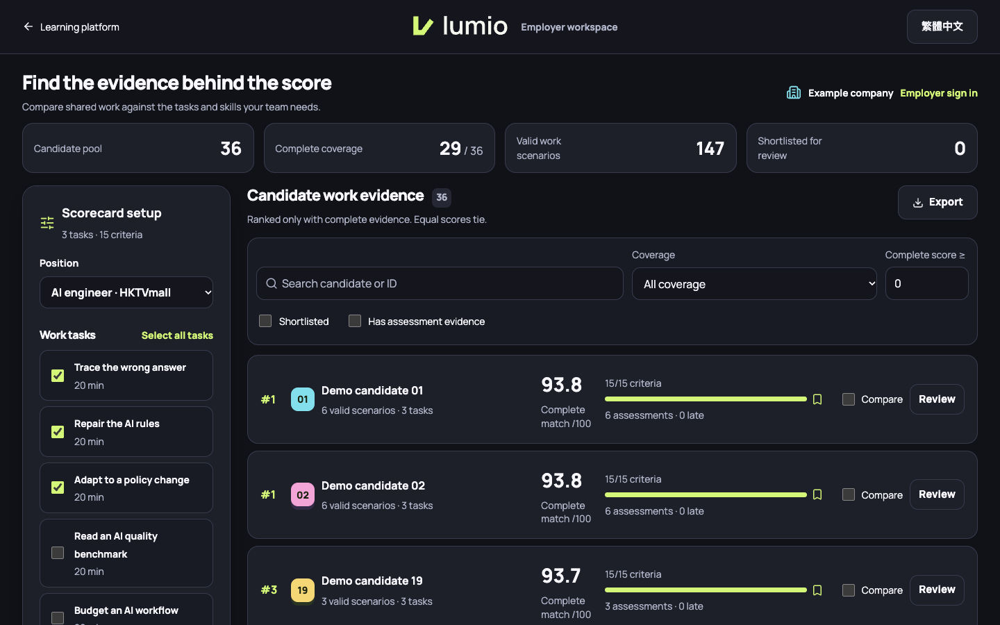
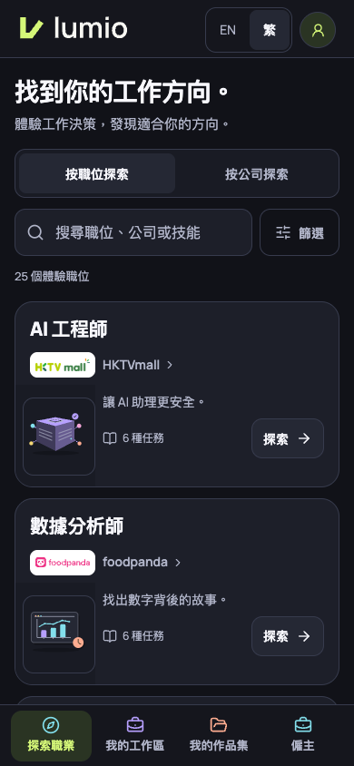
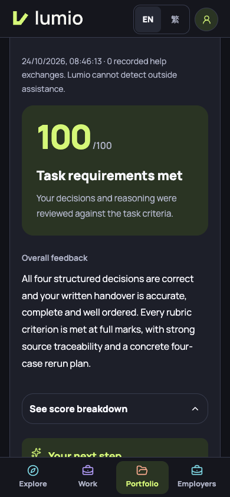
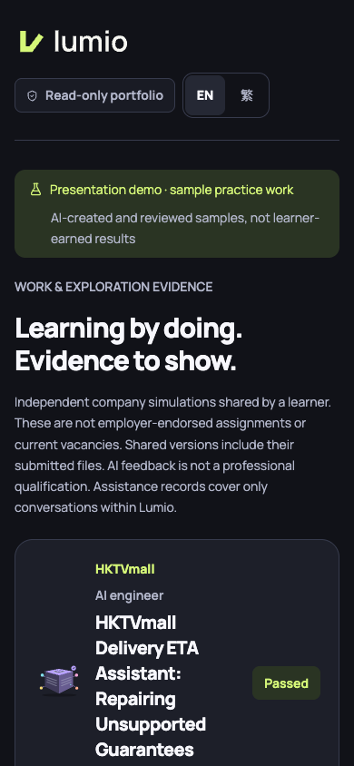
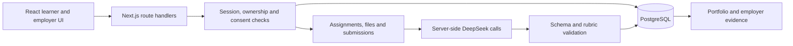

# Lumio

**Explore a career. Do the work. Build evidence of your skills.**

Lumio is a bilingual career exploration and workplace simulation platform for early-career learners in Hong Kong. Instead of choosing a career from a job description alone, learners try realistic assignments, receive feedback on their work and build a portfolio they control.

Built by **Team Smurf for Hack4SDG**, where the team qualified for the final round. This repository contains the complete web application, backend, curriculum, database migrations, deployment configuration and tests.

[Live prototype](https://162.35.19.77/) · [Employer demo](https://162.35.19.77/employers) · [Watch the 44-second demo](docs/media/lumio-demo.mp4) · [Technical architecture](docs/architecture.md)



## What it does

- **Career discovery:** 25 roles and 138 task families, including company-context simulations and core industry practice.
- **Practical assignments:** read synthetic source documents, download an editable workpack, work in familiar tools and upload a finished handover.
- **AI feedback:** criterion-level marks, source-based explanations and next steps in English and Traditional Chinese. Practice offers coach and manager conversations. Independent assessment disables in-app help and accepts one final handover.
- **Private portfolios:** saved drafts, immutable submission versions, original file downloads, data export and selected sharing through expiring, revocable links.
- **Employer workspace:** choose relevant tasks and criterion weights, compare evidence, shortlist and export. Its public preview uses 36 synthetic candidate profiles.

Company names and public context are real. Workplace records, colleagues, rules and candidate profiles are fictional. These are independent simulations without company endorsement.

## A look inside

| Learner workspace | Employer workspace |
| --- | --- |
| [](docs/screenshots/workspace.png) | [](docs/screenshots/employers.png) |
| Download materials, work in your tools, then submit evidence. | Inspect the criteria and evidence behind a score. All candidates shown are synthetic. |

<details>
<summary>Mobile, bilingual feedback and portfolio sharing</summary>

<p>
  
  
  
</p>

Screenshots were captured from the running October 2026 prototype. Feedback and shared work shown here are demonstration examples, not evidence of learner outcomes.

</details>

## How the backend works

**Stack:** Next.js 16, React 19, TypeScript, PostgreSQL 17, Zod, DeepSeek, Docker Compose and Caddy. Vitest covers application logic and Playwright covers browser journeys.



The AI proposes criterion awards and feedback. **Application code validates those awards and calculates the final score and pass conditions.** Task families keep fixed criteria across scenario variations. Published assignment snapshots preserve the version used for each submission.

The backend uses draft revisions to prevent lost updates, request IDs to handle submission retries and evidence fingerprints to reuse compatible saved grades. PostgreSQL-backed quotas and provider leases bound AI usage across app processes. Uploaded files are parsed in a separate process with permission, memory, time and output limits.

Employer scores are weighted averages of recorded criterion achievement. Incomplete evidence remains unranked, equal scores share a rank and server reads recheck company-specific consent and active sharing. [See the data model, request flow and code map.](docs/architecture.md)

## Ethics and limitations

- **Consent and privacy:** external AI review requires consent. Uploads require a confidentiality declaration and recognizable credential screening. Screening cannot detect every sensitive fact.
- **Human judgment:** scores describe performance on a simulation. They are not qualifications, validated predictions of job performance or automatic hiring decisions.
- **Fairness:** bilingual prompts and fixed rubrics support consistency. Human calibration, accessibility pilots and subgroup fairness evaluation remain necessary.
- **Assessment integrity:** Lumio records in-app help but cannot detect outside assistance. Reference answers are included for reproducibility, so the bundled cases are unsuitable for secure hiring assessment.
- **Honest scope:** employer demo profiles are synthetic. RAG retrieval is a proposed extension. The implemented system uses supplied scenario context and direct model calls.

[Read the ethics, privacy and evaluation considerations.](docs/ethics.md)

## Run locally

Requires **Node.js 22 or later** and **Docker with Docker Compose**.

```sh
git clone https://github.com/northlight7/lumio.git
cd lumio/prototype
npm ci
sh scripts/start-local.sh
```

Open [localhost:3100](http://localhost:3100). Setup creates private configuration and database passwords. For live AI features, put your own DeepSeek API key in `.internal/secrets/deepseek_key` at the repository root, then restart the app. Catalog browsing and the presentation demo can be explored without making fresh AI requests.

```sh
cd prototype  # from the repository root
npm run typecheck
npm test
npm run build
```

The default test run skips opt-in database and isolated code-execution suites. Some historical browser audits also require private release evidence. [Setup, deployment and testing details](docs/setup.md) explain the boundaries.

## Explore the repository

| Path | Contents |
| --- | --- |
| [`prototype/src/app`](prototype/src/app) | Pages and HTTP API routes |
| [`prototype/src/lib`](prototype/src/lib) | AI authoring and grading, sessions, files, consent and employer scoring |
| [`prototype/curriculum`](prototype/curriculum) | Reproducible bilingual scenario snapshots and reference rubrics |
| [`prototype/migrations`](prototype/migrations) | 17 ordered PostgreSQL migrations |
| [`prototype/scripts`](prototype/scripts) | Local setup, curriculum operations, backup and restore |
| [`prototype/tests`](prototype/tests) | Unit, integration, adversarial and browser tests |
| [`docs`](docs) | Architecture, ethics, setup, screenshots and demo film |

Next steps are human grading calibration, learner and employer pilots, accessibility research and evaluation of a retrieval layer. Email verification, account recovery, billing and SSO are not implemented.

See [asset credits and project licensing status](NOTICE.md). This public portfolio snapshot excludes deployment secrets, user databases, private uploads and internal working history.
