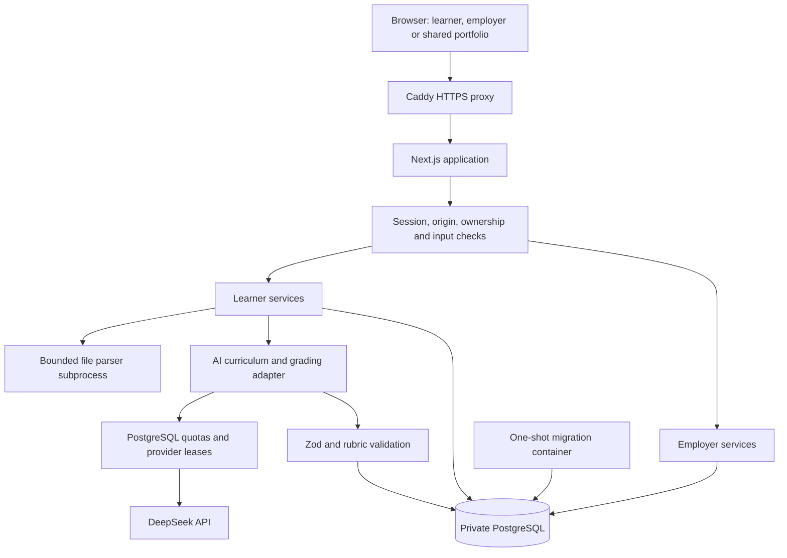

# Technical architecture

Lumio is a Next.js application with server-side route handlers and PostgreSQL persistence. The web app, migrations, curriculum and operational scripts are all included under `prototype/`.

## System boundaries

The browser never receives the provider API key. Deployment uses file-backed secrets, separate migration and application database roles, an app container running as an unprivileged user and a database without a public port in the production Compose configuration. Development binds PostgreSQL to `127.0.0.1:55439`.

## One assignment, end to end

1. A learner starts a guest or registered session. A random session token is stored as a hash in PostgreSQL and sent in an HttpOnly cookie.
2. An attempt chooses a published scenario and pins its identity. The server records the start and deadline. Later stages check prerequisite completion.
3. Draft saves use revision numbers. A stale update receives a conflict instead of overwriting newer work.
4. Public workpacks are assembled from allowed task fields, excluding private grading expectations.
5. Uploads are checked for size, format, ownership declaration and recognizable secrets. A separate Node process extracts readable content. Original bytes, hashes, parser limitations and extraction metadata are stored privately.
6. Submission requires AI consent. A database transaction reserves the request ID, checks the revision and captures receipt time before the external request.
7. DeepSeek receives scenario context, the reference rubric and learner evidence. Learner text and file contents are marked as untrusted evidence in the grading prompt.
8. Zod validates the response. Code checks criterion identity, uniqueness and award bounds, then sums the marks. Passing requires at least 70/100, enough substantive evidence and at least half the available marks on each critical criterion.
9. A final transaction saves the submission and evaluation. Retries with the same request ID recover the existing receipt. Incompatible reuse is rejected.

Timing is separate from quality. Late work can be accepted and marked late without silently changing rubric marks. Evidence fingerprints let unchanged, compatible work reuse a saved grade with a new receipt.

See [`services.ts`](../prototype/src/lib/services.ts), [`ai-curriculum.ts`](../prototype/src/lib/ai-curriculum.ts), [`attachments.ts`](../prototype/src/lib/attachments.ts) and [`workspace-timing.ts`](../prototype/src/lib/workspace-timing.ts).

## AI authoring and review

The implementation calls DeepSeek's chat-completions API directly with structured JSON responses and the model identifier `deepseek-flash`.

Task families provide fixed public criteria and weights. Authoring produces bilingual documents, decisions, private expected evidence, answers and exemplars. Publication gates check schema, public workpacks and rubric consistency. Model reviews include a public-only solver, a private expectation audit and comparison with earlier scenarios. These reduce known failure modes but do not establish independent human validity.

The four committed catalogs contain **360 snapshots**, including older and advanced cases. Migrations retire or hide superseded entries, so this differs from the active count in an existing deployment. The application defines **25 roles and 138 task families**.

There is no implemented vector database, embedding pipeline or RAG retrieval service. Context comes from scenario documents and supplied company information. Future retrieval needs source rights, provenance, sanitization and evaluation.

## Persistent data

| Group | Tables |
| --- | --- |
| Identity | `learners`, `sessions`, `employer_accounts`, `employer_sessions` |
| Learning evidence | `attempts`, `submissions`, `messages`, `attachments` |
| Curriculum | `task_variants` stores published task and rubric snapshots |
| Sharing | `shares`, `employer_evidence_consents`, `employer_shortlists` |
| AI coordination | `ai_requests`, `grading_requests`, `quotas`, `generation_locks`, `provider_leases` |
| Migration tracking | `schema_migrations` |

Relational constraints and transactions protect ownership and lifecycle boundaries. JSONB stores versioned task and evaluation structures. The restricted `lumio_app` role has table-specific grants, with no UPDATE grant on published task snapshots. The migration role changes schema and imports curriculum.

See [`migrations/`](../prototype/migrations) and [`migrate.mjs`](../prototype/scripts/migrate.mjs).

## Employer scoring and disclosure

For each required criterion, code converts valid awards into percentages and averages them across distinct scenarios. Employer weights produce an absolute weighted score. Ranking is separate and does not change the score.

The latest record is selected before validation. Invalid new evidence cannot revive an older higher score. Rubric versions, criterion IDs and maximum points must match. Missing coverage prevents a complete rank. Equal displayed scores share a competition rank.

Authenticated reads recheck company-specific learner consent, share expiry and revocation. Responses contain pseudonymous identifiers, criterion awards, safe generated explanations, assistance counts and timing. They exclude identity, original work, files, chats and free-form evaluation prose. Learner-controlled portfolio links are a separate disclosure path and can expose selected submitted work and original files.

See [`employer.ts`](../prototype/src/lib/employer.ts) and [`employer-scoring.ts`](../prototype/src/lib/employer-scoring.ts).

## API map

| Route | Responsibility |
| --- | --- |
| `/api/session`, `/api/auth`, `/api/me` | Sessions, registration, login, profile and account erasure |
| `/api/variations`, `/api/attempts` | Discover scenarios and start work |
| `/api/attempts/[id]` | Load and save an owned draft |
| `/api/attempts/[id]/materials` | Download public work materials |
| `/api/attempts/[id]/attachments` | Upload work with a privacy declaration |
| Attempt `/check`, `/submit`, `/chat` routes | Practice review, final handover and colleague dialogue |
| `/api/portfolio`, `/api/export`, `/api/share` | Evidence history, export and sharing |
| `/api/employer/*` | Employer login, consent, requirements and shortlist |
| `/api/health` | Database reachability and production AI configuration health |

## Operations

Docker Compose runs PostgreSQL, a migration job, the standalone Next.js app and Caddy. The VPS override adds memory limits and bounded logs. Backup and restore helpers use private PostgreSQL dumps and a separate restore database.

PostgreSQL-backed provider leases coordinate AI concurrency. Daily user and global quotas protect the API budget. Timeouts, bounded retries and structured errors expose provider failures instead of inventing successful grades.

Production load capacity, grading validity and suitability for consequential hiring remain unestablished. Published reference answers prevent the bundled curriculum from functioning as a confidential assessment bank.
